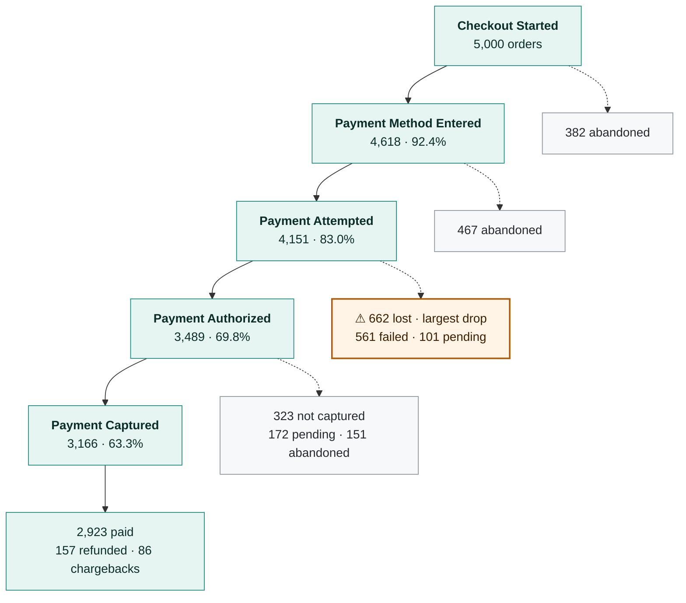
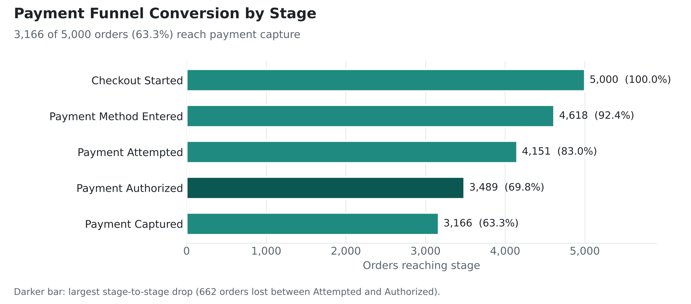
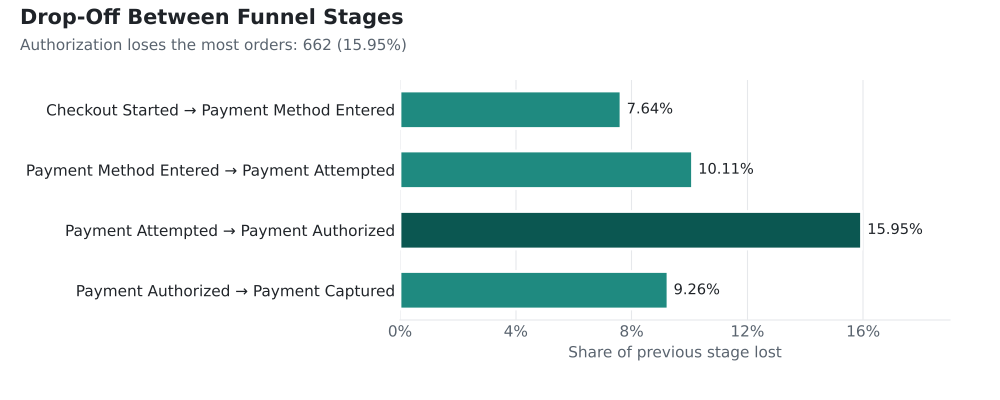
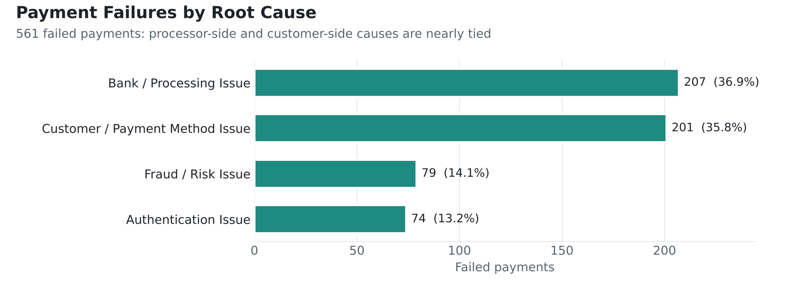
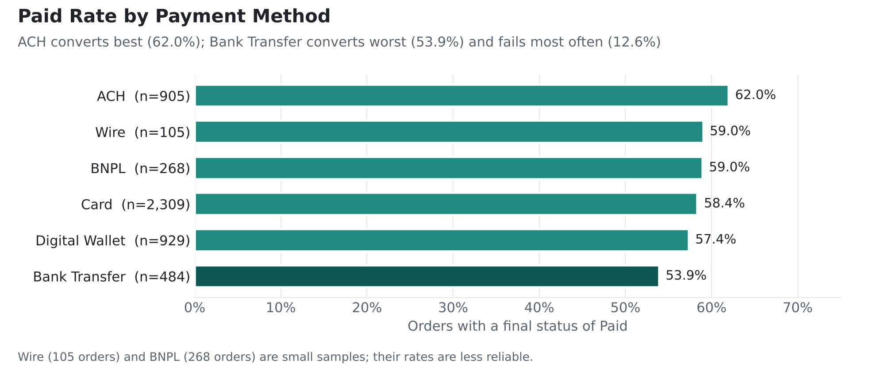
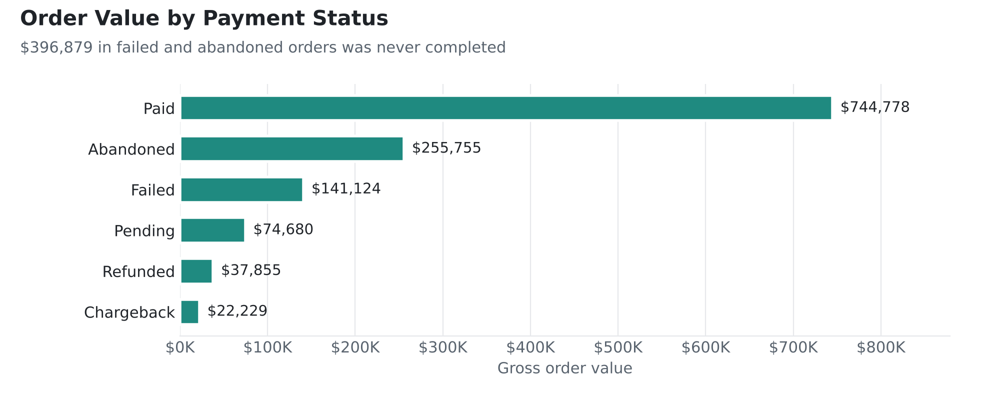
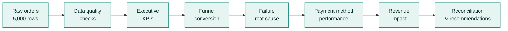

# Payment Funnel Analysis: SQL · DuckDB · Hex

**Where do payments fail on a digital payments platform, why do they fail, and how much order value is at stake?**

I analyzed **5,000 orders** from a fictional fintech payments platform using SQL. I measured conversion at each payment stage, found where orders drop off, classified **561 payment failures** by root cause, and compared performance across six payment methods (Card, Digital Wallet, ACH, Bank Transfer, BNPL, Wire).

---

## 📌 Results at a Glance

| Metric | Value |
|---|---|
| Orders analyzed | **5,000** (Jan 2024 – Apr 2025) |
| Paid rate | **58.46%** (2,923 orders) |
| Payment captured | **63.32%** (3,166 orders, including 157 later refunded and 86 chargebacks) |
| Abandonment rate | **20.00%** (1,000 orders) |
| Payment failure rate | **11.22%** (561 orders) |
| Biggest drop-off | **Authorization:** 662 orders lost (15.95%) |
| Order value never completed (failed + abandoned) | **$396,879** |

> **Why two conversion numbers?** Captured payments include orders that were later refunded or charged back. They reconcile exactly: 2,923 paid + 157 refunded + 86 chargebacks = 3,166 captured.

---

## 🔀 The Payment Funnel

Every order is accounted for: each one either moves to the next stage or exits with a final status.



---

## 🔍 Key Findings

1. **Authorization is the biggest bottleneck.** 662 orders (15.95%) drop between Payment Attempted and Payment Authorized, the largest stage-to-stage loss.
2. **Failures split evenly between processor and customer causes.** Bank/processing issues cause 36.90% of failures and customer/payment-method issues cause 35.83%. Fraud (14.08%) and authentication (13.19%) make up the rest.
3. **Card has the most failures because it has the most volume.** Card accounts for 44.56% of failures but also 2,309 of 5,000 orders, and its failure rate (10.83%) is in line with other methods. **Bank Transfer has the highest failure rate (12.60%)** and the lowest paid rate (53.93%).
4. **849 orders are abandoned before a payment is even attempted:** 382 at checkout and 467 after entering a payment method.

## 💡 Recommendations

- **Reduce authorization failures:** review processor timeouts, gateway errors, and bank rejections with the payment processor, and add retries for recoverable declines.
- **Prevent customer-side failures:** check card expiry and billing address (AVS) before the payment is submitted.
- **Review fraud screening on Bank Transfer,** balancing fraud prevention against false declines.
- **Reduce early abandonment:** review the checkout and payment-method steps for friction.
- **Track failure *rates* by payment method,** not just counts.

---

## 📊 Visuals











---

## 🛠️ Approach



1. **Validated the data first:** 5,000 records, 5,000 unique orders, 0 duplicate order IDs, and no missing values in the six critical fields. → [`01_data_quality_checks.sql`](sql/01_data_quality_checks.sql)
2. **Built executive KPIs** for paid rate, abandonment, failure rate, and paid revenue. → [`02_executive_kpis.sql`](sql/02_executive_kpis.sql)
3. **Reconstructed the funnel** by mapping each order's furthest stage to five steps, then used `LAG()` to calculate stage-to-stage drop-off. → [`03_funnel_conversion.sql`](sql/03_funnel_conversion.sql)
4. **Classified failures by root cause** with `CASE` logic on decline reasons. Checking the output against the raw decline reasons showed that 58 address (AVS) mismatches had been left unclassified. I fixed the rule so every failure has a category. → [`04_failure_analysis.sql`](sql/04_failure_analysis.sql)
5. **Compared payment methods by rate, not just count,** to avoid volume bias. → [`05_payment_method_performance.sql`](sql/05_payment_method_performance.sql)
6. **Measured order value by final status.** → [`06_revenue_impact.sql`](sql/06_revenue_impact.sql)
7. **Reconciled every order** across funnel stage and final status. → [`07_funnel_outcome_reconciliation.sql`](sql/07_funnel_outcome_reconciliation.sql)

**SQL techniques:** CTEs · window functions (`LAG`, `FIRST_VALUE`, `SUM() OVER`) · `CASE` classification · `FILTER` aggregates · `NULLIF` for safe division · `UNION ALL` stage definitions

---

## ⚠️ Data Notes & Limitations

- **Synthetic dataset.** Results demonstrate method, not real-world benchmarks.
- **Funnel stages are reconstructed** from each order's furthest recorded stage, not validated against event timestamps.
- **Status questions to confirm:** 151 orders reached Payment Authorized but are marked Abandoned, and 172 authorized orders are still Pending. In a real setting I would confirm with operations how these statuses are assigned before treating them as lost revenue.
- **Mixed currencies:** 277 orders (5.5%) are in CAD, EUR, or GBP. Order values are summed as recorded, without currency conversion.
- **Failed and abandoned order value is not realized loss.** Refunds and chargebacks need reconciliation before reporting retained revenue.
- **Small samples:** Wire (105 orders) and BNPL (268 orders) rates are less reliable.

---

## 📁 Repository Structure

```
payment-funnel-analysis-fintech/
├── README.md
├── data/
│   ├── README.md                          # Data dictionary
│   ├── fintech_payment_funnel_orders.csv  # 5,000 orders (tab-delimited)
│   └── fintech_payment_products.csv       # 20 products
├── sql/
│   ├── 00_setup.sql
│   ├── 01_data_quality_checks.sql
│   ├── 02_executive_kpis.sql
│   ├── 03_funnel_conversion.sql
│   ├── 04_failure_analysis.sql
│   ├── 05_payment_method_performance.sql
│   ├── 06_revenue_impact.sql
│   └── 07_funnel_outcome_reconciliation.sql
└── images/
    ├── funnel_conversion.png
    ├── funnel_dropoff.png
    ├── failure_classification.png
    ├── paid_rate_by_method.png
    └── revenue_by_status.png
```

## ▶️ How to Run

The analysis was built in a Hex notebook. To reproduce it locally with [DuckDB](https://duckdb.org/), run the files in order from the repository root:

```sql
-- start the DuckDB CLI with: duckdb
.read sql/00_setup.sql
.read sql/03_funnel_conversion.sql
```

## ⏭️ Next Steps

- Add monthly trends in conversion and failure rates
- Break failure and abandonment rates down by checkout device, traffic source, and customer segment (fields already in the dataset)
- Build an executive dashboard with alert thresholds for authorization failures

---

**Tools:** SQL · DuckDB · Hex
**Skills:** Funnel analysis · KPI design · Root-cause classification · Data validation · Reconciliation · Business recommendations

**Shirley Landon** · [LinkedIn](https://www.linkedin.com/in/shirleylandon/) · [GitHub](https://github.com/shirleylandondata)
